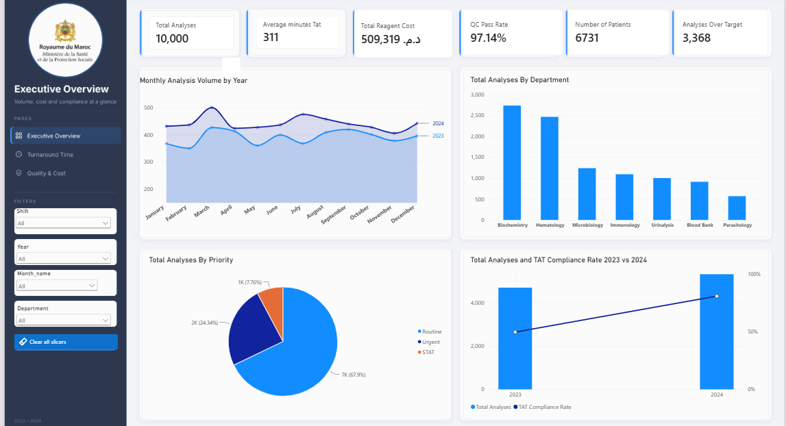
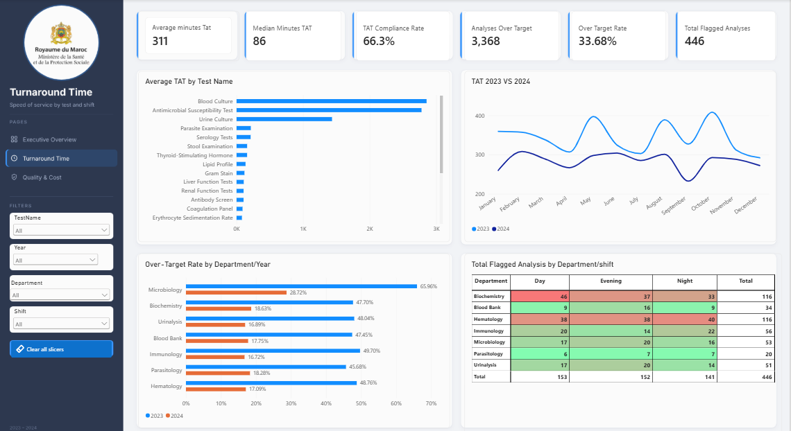
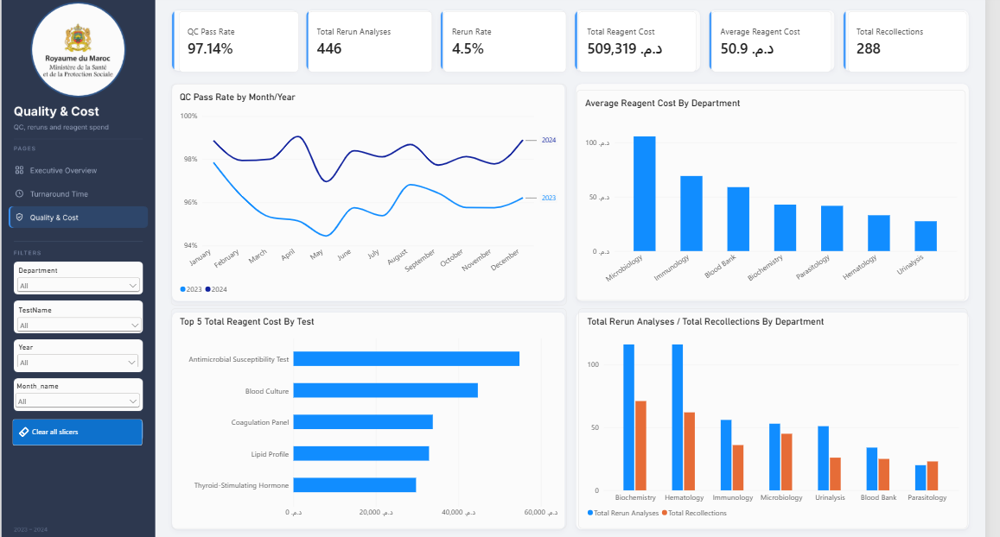

# 🧪 Hospital Laboratory Performance Analytics

**End-to-end Power BI solution analyzing 10,000 anonymized laboratory records (2023–2024): workload, turnaround time (TAT), quality control, repeat work, and reagent cost.**



---

## 📌 Main Result

Laboratory activity **increased in 2024**, and both **TAT and QC performance improved**. Even so, overall **TAT compliance was only 66.3%**: about one in three analyses still exceeded its test-specific target. That makes delay reduction the biggest improvement opportunity.

| KPI | Result | What it means |
|---|---|---|
| Total analyses | **10,000** | Two-year laboratory workload |
| Distinct patients | **6,731** | Patients represented in the data |
| Average / median TAT | **311 / 86 min** | The large gap shows a few extreme delays are driving the average |
| TAT compliance | **66.3%** | Share of analyses completed within target |
| QC pass rate | **97.14%** | Overall analytical quality |
| Reruns | **446 (4.5%)** | Repeat testing on the same sample |
| Recollections | **288** | A new patient sample was required |
| Reagent cost | **509.3K MAD** | About 50.9 MAD per analysis |

---

## ❓ Business Questions

1. How did laboratory activity change by month, year, department, test, shift, and priority?
2. Which tests and operating areas contribute most to turnaround-time delays?
3. How strong are QC performance, rerun control, and recollection control?
4. Which tests and departments drive the greatest reagent cost?

---

## 🛠️ Tools & Skills

`Power BI` · `Power Query` · `DAX` · `SQL` · `Star schema design` · `Data profiling & cleaning` · `KPI development` · `Dashboard design`

---

## 🔄 Workflow

**Ingest → Profile → Clean → Model → Measure → Visualize → Validate**

- **Power Query:** assigned data types, standardized categories, inspected missing values, validated duplicates, and derived the date key
- **Data model:** a star schema with one fact table and two dimensions, using one-to-many, single-direction relationships

```
   Dim_Date ──1:*──►  fact_labAnalysis  ◄──*:1── dim_TestDescription
```

- **DAX:** measures for TAT compliance, over-target rate, QC pass rate, rerun rate, and cost KPIs
- **SQL:** validated measure results against the source data

<!-- Optional: add a screenshot of the model view -->
<!--  -->

---

## 📊 Dashboard 1: Executive Overview


- The laboratory completed **10,000 analyses for 6,731 patients**.
- Activity was higher in 2024 than in 2023, and **TAT compliance also improved**.
- **Biochemistry and Hematology** carried the largest workloads.
- **March** was the busiest month in the combined monthly view.
- By priority, the mix was about **68% Routine, 24% Urgent, and 8% STAT**.

## ⏱️ Dashboard 2: Turnaround Time



- Average TAT was **311 min**, but the median was **86 min**: a small number of very long analyses inflate the average.
- **3,368 analyses (33.68%)** exceeded their target.
- **Blood Culture, Antimicrobial Susceptibility, and Urine Culture** had the longest average TAT, partly because microbiology requires incubation.
- Monthly TAT was **consistently lower in 2024** than in 2023.

## 💰 Dashboard 3: Quality & Cost



- The QC pass rate was **97.14%**, with generally stronger monthly results in 2024.
- The lab recorded **446 reruns and 288 recollections**. Reruns consume reagent, analyzer, and staff time; recollections also require a new sample from the patient.
- **Microbiology** had the highest average reagent cost, and **Antimicrobial Susceptibility and Blood Culture** were the main test-level cost drivers.
- **Biochemistry and Hematology** had the most repeat work in absolute terms, so rates are needed for a fair comparison because they also process the most volume.

---

## ✅ Recommendations

1. **Investigate the longest-TAT cases** first, since extreme delays are what push the average up.
2. **Evaluate microbiology against its own targets** instead of comparing raw duration with rapid tests.
3. **Use counts and over-target rates together** when comparing departments and shifts.
4. **Separate rerun root causes from recollection root causes**, because they need different corrective actions.
5. **Review high-cost tests alongside volume, clinical need, and rerun activity.**

---

## 📄 Full Case Study

See [the full report (PDF)](Portfolio_Report.pdf) for the complete write-up.

## 🗂️ Data

This project uses **anonymized real laboratory data** (10,000 records, 2023–2024), used with permission. No patient-identifying information is included, and the raw dataset is not published in this repository; only aggregated results are shown.

---

**Author:** Khalid Ndari · BI & Data Analyst · Calgary, AB
[LinkedIn](https://www.linkedin.com/in/ndari-khalid-33670121b)
